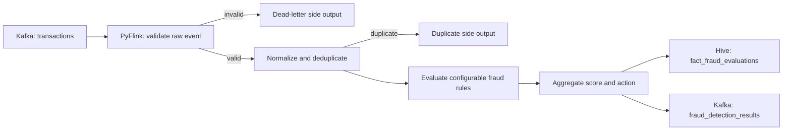

# Fraud Detection Streaming Pipeline

A Python streaming application for detecting suspicious financial transactions.
The project is being developed with Apache Kafka and PyFlink, with Hadoop/Hive
for analytics storage, PostgreSQL for service initialization and the Hive
metastore, and Redis for cache/state integrations.

> **Development status:** the components are being assembled, but the complete
> streaming job is not yet wired into `main.py`. The diagram below describes the
> intended flow across the current components; it is not an end-to-end runnable
> job yet. This repository does not currently implement a Spark,
> Bronze/Silver/Gold, PyDeequ, or branch-and-merge workflow.

## Pipeline Flow



The transaction contract and normalization/deduplication components are in
place. Rule configuration and supporting scoring components are also present,
but the complete orchestration, side-output routing, and sink connections still
need to be integrated and tested as a streaming job.

## Current Capabilities

- PyFlink-oriented transaction processing components and Kafka endpoint
  configuration.
- Pydantic contracts for raw transactions, normalized transactions, fraud
  evaluation records, fraud alerts, duplicate events, and invalid events.
- Transaction normalization for decimal amounts, coordinates, timestamps, and
  categorical values.
- A keyed deduplication component with a five-minute event-time TTL.
- Configurable fraud thresholds for amount, device, IP address, speed, and
  velocity rules, with low/medium/high levels and score factors.
- Hive and Kafka sink definitions, plus Hadoop, Hive, Kafka, PostgreSQL, and
  Flink Docker Compose stacks.
- Redis integrations for exchange-rate caching and transaction sliding-window
  data.

## Transaction Contract

The raw Kafka transaction is validated against `src/contracts/raw_events.py`.
Optional account and merchant fields may be null.

| Field | Expected value | Description |
|---|---|---|
| `event_id` | string | Event identifier |
| `transaction_id` | string | Transaction identifier used for deduplication |
| `user_id` | string | User identifier |
| `amount` | positive decimal | Transaction amount |
| `currency` | string | Currency code; normalized to uppercase |
| `segment` | string | User segment; normalized to lowercase |
| `transaction_type` | string | Transaction type; normalized to lowercase |
| `direction` | string | Transaction direction; normalized to lowercase |
| `sender_account` | string or null | Sender account |
| `receiver_account` | string or null | Receiver account |
| `merchant_id` | string or null | Merchant identifier |
| `ip_address` | string | Client IP address |
| `device_id` | string | Device identifier |
| `device_type` | string | Device type; normalized to lowercase |
| `latitude`, `longitude` | numeric | Transaction coordinates |
| `status` | string | Transaction status; normalized to lowercase |
| `event_timestamp` | string | Event-time timestamp |

The cleaned transaction contract and the fraud output contracts are defined in
`src/contracts/cleaned_events.py` and `src/contracts/score_events.py`.

## Fraud Scoring and Configuration

Application defaults and rule thresholds live in `src/config/config.yaml`;
Pydantic settings models are in `src/models/settings/`. The rule configuration
includes thresholds and optional factors for segment, direction, and
transaction type. Rule windows are configured individually (for example,
amount uses a 24-hour window, device uses one hour, and velocity uses one
minute); there is no single five-minute window shared by every rule.

The aggregate score policy currently sets the `otp`, `review`, and `block`
cutoffs to `50`, `100`, and `150`. Keep environment-specific credentials and
overrides in `.env`, which is ignored by Git; do not commit secrets.

The exchange-rate client is implemented in
`src/integrations/api/exchange_rate.py` and uses Redis as a cache. Redis sliding
window helpers are in `src/integrations/redis/`.

## Project Structure

```text
.
├── config/                         # Hadoop and Hive XML configuration
├── docker/
│   ├── flink/                      # Flink Compose, image, and entrypoint
│   ├── hadoop/                     # Hadoop Compose definition
│   ├── hive/                       # Hive Compose definition and image
│   ├── kafka/                      # Kafka Compose definition
│   └── postgres/
│       ├── init/                   # PostgreSQL schema and seed SQL
│       └── docker-compose.postgres.yaml
├── src/
│   ├── application/
│   │   ├── bootstrap/              # Schema/bootstrap setup
│   │   └── transform/              # Transaction transformations and helpers
│   ├── common/                     # Shared names, keys, tags, and formats
│   ├── config/                     # Settings loader and application YAML
│   ├── contracts/                  # Raw, cleaned, scored, and side-event models
│   ├── integrations/
│   │   ├── api/                    # Exchange-rate API client
│   │   └── redis/                  # Redis client and sliding-window helpers
│   ├── models/                     # Domain, endpoint, score, and settings models
│   ├── rules/                      # Fraud rule evaluation components
│   ├── udf/                        # Flink user-defined functions
│   └── utils/                      # Flink and Hive helpers
├── tests/                          # Unit and integration tests
├── main.py                         # Placeholder entry point; no job orchestration yet
├── Project_Folders_Structure_Blueprint.md
├── pyproject.toml                  # Dependencies and tool configuration
├── start-all.sh                    # Start Docker Compose stacks
├── stop-all.sh                     # Stop stacks and remove Compose volumes
└── uv.lock                         # Resolved Python dependencies
```

See [Project_Folders_Structure_Blueprint.md](Project_Folders_Structure_Blueprint.md)
for directory responsibilities and extension guidance.

## Getting Started

### Prerequisites

- Python 3.10 (required by `pyproject.toml`)
- [uv](https://docs.astral.sh/uv/)
- Docker with Docker Compose v2
- Bash-compatible shell (Git Bash or WSL on Windows)

### Install Python dependencies

```bash
uv sync --group dev
```

### Configure and start infrastructure

Create a local `.env` containing the environment variables required by the
Docker Compose files. Do not commit this file.

```bash
bash start-all.sh
```

The script starts Hadoop, Hive, Kafka, PostgreSQL, and Flink, and creates the
external `hadoop_net` Docker network if it does not exist. Hive's metastore
PostgreSQL uses host port `5432`; the separate application PostgreSQL container
uses host port `5433`.

> **Data warning:** `stop-all.sh` runs Compose with `down -v`. This removes the
> Compose-managed volumes, including persisted service data.

### Application entry point

```bash
uv run python main.py
```

`main.py` is currently a placeholder and does not start the streaming pipeline.

### Tests and lint

```bash
uv run pytest
uv run ruff check .
```

## Roadmap

- Wire the Kafka source, validation/normalization, fraud evaluation, and sinks
  into a runnable Flink job.
- Route invalid and duplicate events to configured side-output sinks.
- Add end-to-end tests for the complete stream and its failure paths.
- Finalize and test the state/window behavior for each configured rule.
- Normalize transaction amounts to the configured base currency as part of the
  processing flow.

## License

TODO
